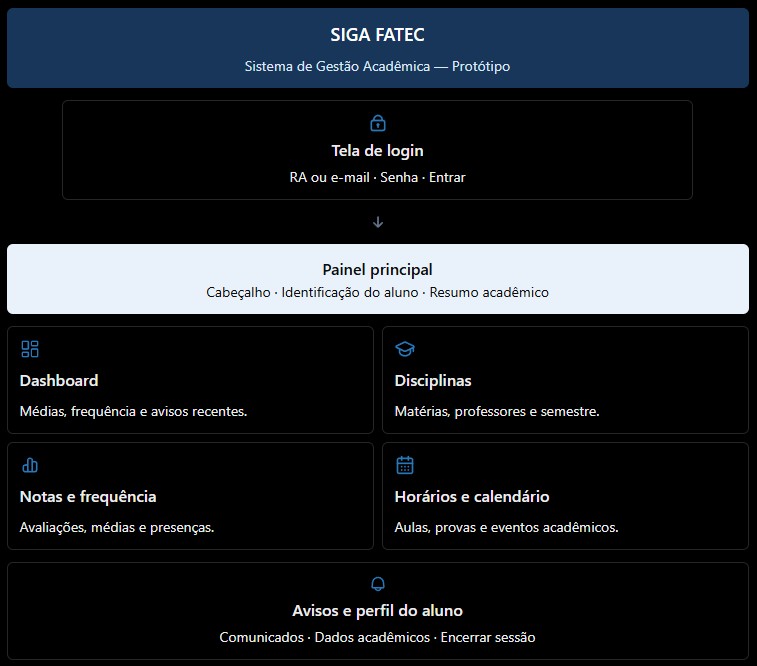
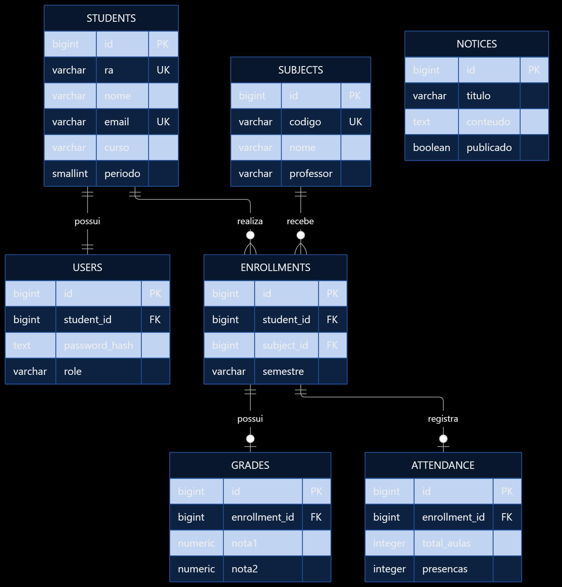

# SIGA_FATEC_REMAKE
Dado o layout do site, esse repositorio demonstra um layout mais intuitivo para os alunos

## TECNOLOGIAS
### FRONT-END
    
            
          
          
            
          
          
            
          

## **LAYOUT FRONT-END**

Uma breve introdução de como foi planejado a interface do usuario, atendendo a todos os requisitos da plataforma e uma gama de cores mais amigavel

## **SCHEMA BANCO DE DADOS**

Foi proposto o PostgreSQL, planejado com usando as tabelas students, users, subjects, enrollments, grades, attendance e notices. As relações utilizam chaves primárias e estrangeiras para garantir a integridade dos dados.

## **MODELO DE DESENVOLVIMENTO**

Por conta do siga ser um sistema publico, ou seja, regras ja definidas perante a lei, foi pensado no cascata porem como o projeto em si é uma melhora do atual foi proposto um modelo 'hibrido' de desenvolvimento na onde cada estapa da cascata fosse uma evolução gradual do sistema atual, adcionando funcionalidades e removendo pontos 'problematicos' alem da análise de riscos, implementação de testes e avaliação a cada ciclo.
